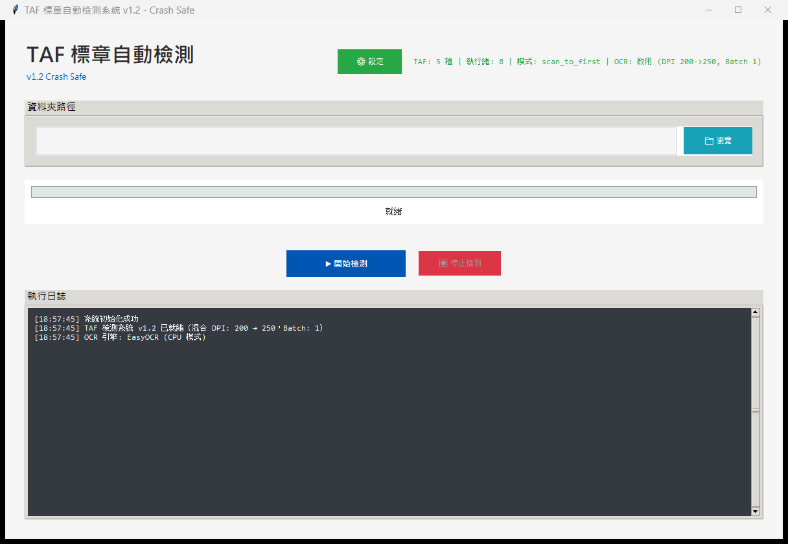

============================================================================
TAF 標章自動檢測系統 v1.2 (TAF Detector) - 使用說明文件
============================================================================

歡迎使用 TAF 標章自動檢測系統。本程式專為檢測 PDF 報告中的 TAF 標章而設計，
具備自動 OCR 文字識別、領域別比對與防呆除錯功能。

v1.2 版本特別針對穩定性與記憶體管理進行強化，並支援無 Python 環境直接執行。

----------------------------------------------------------------------------
一、 快速啟動 (Quick Start)
----------------------------------------------------------------------------
1. 請確認 `TAF_Detector_v1.2.exe` 與 `models` 資料夾、`logo.ico` 位於同一目錄。
2. 雙擊 `TAF_Detector_v1.2.exe` 啟動程式。
   - 首次啟動可能需要幾秒鐘解壓縮核心元件，請耐心等待 Splash 啟動畫面。
3. 若您有自訂的 `DomainMapping.xlsx` (領域對照表)，請由後續步驟載入。

----------------------------------------------------------------------------
二、 介面操作說明
----------------------------------------------------------------------------
1. 【資料夾路徑選擇】
   - 點擊「📁 瀏覽」按鈕，選擇存放 PDF 報告的資料夾。
   - 注意：該資料夾內必須包含 `DomainMapping.xlsx` 檔案，否則無法開始檢測。

2. 【參數設定 (⚙ 設定)】
   - 點擊右上角的「設定」按鈕可調整進階參數：
     - [執行緒數量]: 建議設定為 2~6。若電腦記憶體較小 (8GB以下)，建議設為 4。
     - [掃描模式]:
       - "掃到為止": 只要在一頁中的右上方找到符合的 TAF 標章即停止該檔掃描 (速度快)。
       - "全掃描": 強制掃描每一頁 (速度慢，但均能檢出)。
     - [OCR 參數]:
       - Low DPI / High DPI: 調整識別清晰度。預設 200/250 即可。(覺得辨識結果精準度不如意可以調整此設定建議每次往上調+50即可,例如覺得辨識錯誤的太多,往上調整到 250/300或 200/300)
       - Batch Size: 批次處理量，設為 1~4 可平衡速度與記憶體。(如果只有CPU可以不用動,往上調整不會加快速度)
     - [TAF 編號管理]: 可在此新增、修改或刪除要偵測的 TAF 編號與關鍵字。

3. 【開始與停止】
   - 點擊「▶ 開始檢測」：程式將自動讀取 PDF 並進行 OCR 辨識。
   - 點擊「⏹ 停止檢測」：立即中斷目前任務。

4. 【狀態監控】
   - 下方「執行日誌」會即時顯示目前進度與錯誤訊息。
   - 若記憶體佔用過高，系統會自動顯示警告並暫停或降速，請勿驚慌。

----------------------------------------------------------------------------
三、 注意事項 (Important Notes)
----------------------------------------------------------------------------
1. **防休眠機制**: 
   程式執行期間會定時模擬按下 "Num Lock" 鍵以防止電腦進入睡眠模式。
   若您發現 Num Lock 燈號閃爍屬正常現象。

2. **記憶體保護**:
   本程式內建記憶體監控 (Crash Safe)。若偵測到記憶體不足 (如 >11GB 使用量)，
   會自動強制釋放資源或暫停 30 秒等待系統恢復，避免程式崩潰。

3. **崩潰恢復**:
   萬一程式發生不可預期的錯誤而關閉，系統會嘗試在離開前儲存
   `Crash_Recovery_Report.xlsx`，確保已檢測的進度不遺失。

4. **結果輸出**:
   檢測完成後，結果會自動儲存為 `Full_Report.xlsx` (完整報告) 
   與 `AutoSave_Progress.xlsx` (進度備份)。

----------------------------------------------------------------------------
四、 版本更新說明 (v1.1.1 -> v1.2)
----------------------------------------------------------------------------
本版本 (v1.2) 重點在於「穩定性」與「效能優化」，主要改進如下：

1. **新增 Crash Safe (防崩潰) 機制**:
   - 加入全域異常捕捉，程式出錯時會自動儲存當下進度，避免重跑。
   - 針對記憶體洩漏 (Memory Leak) 加入主動監控與強制 GC (垃圾回收)。

2. **OCR 引擎優化**:
   - 支援「混合 DPI 策略」：先用低解析度快速掃描，失敗再自動切換高解析度重試，大幅提升速度與準確率。
   - 開放 EasyOCR Batch Size 設定，讓使用者可依電腦效能自行調整。

3. **相依性打包修正**:
   - 內建 `logo.ico` 與預設模型，無須額外安裝 PyTorch 環境。

4. **其他改進**:
   - 優化 UI 佈局，支援高解析度螢幕顯示。
   - 修正了僅處理器的筆電上可能發生的執行緒分配不均問題。

============================================================================
如有任何問題，可以聯繫我
============================================================================
